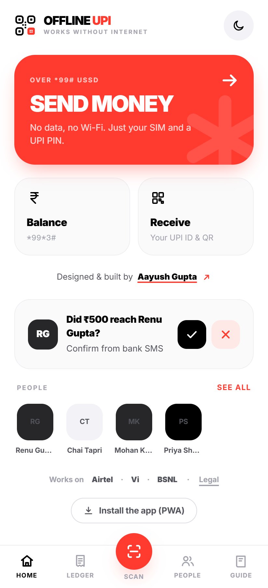
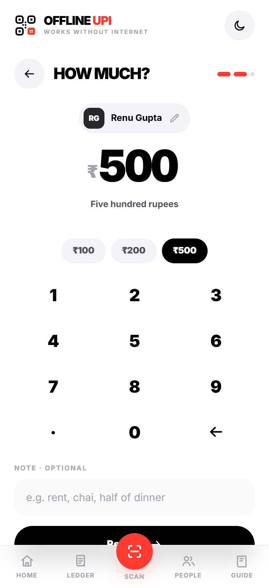
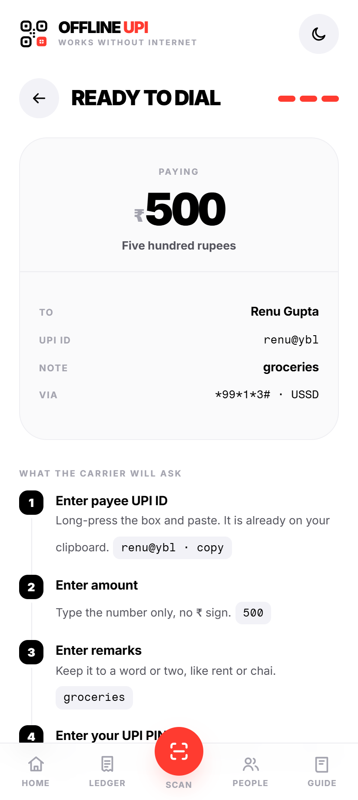
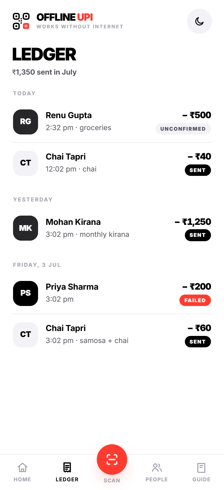
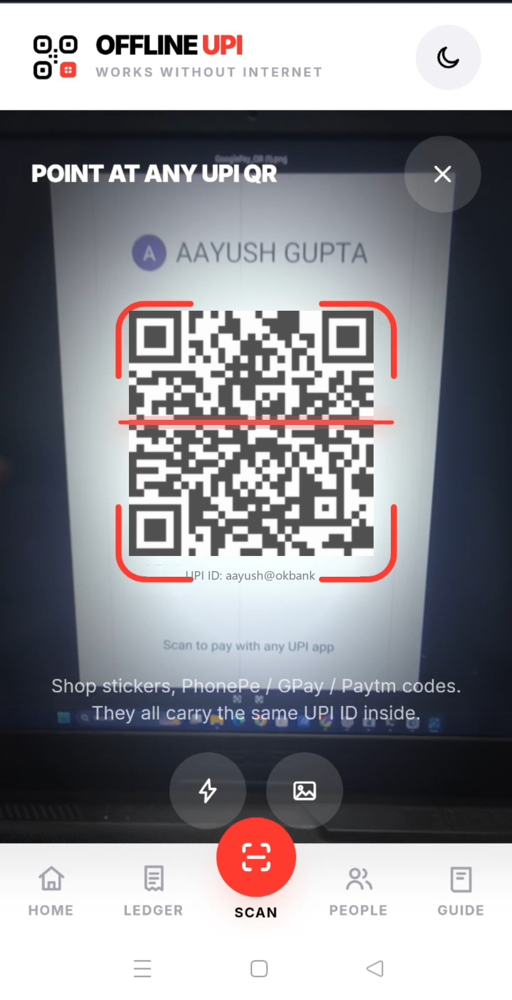
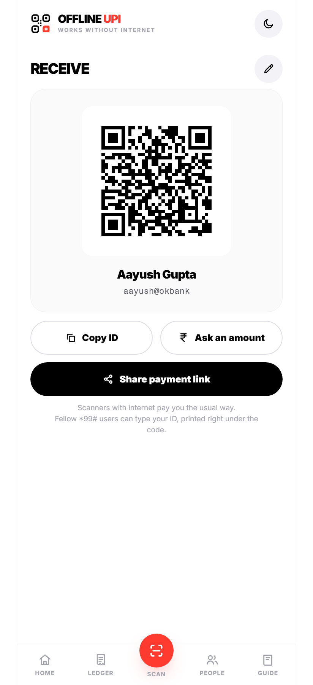
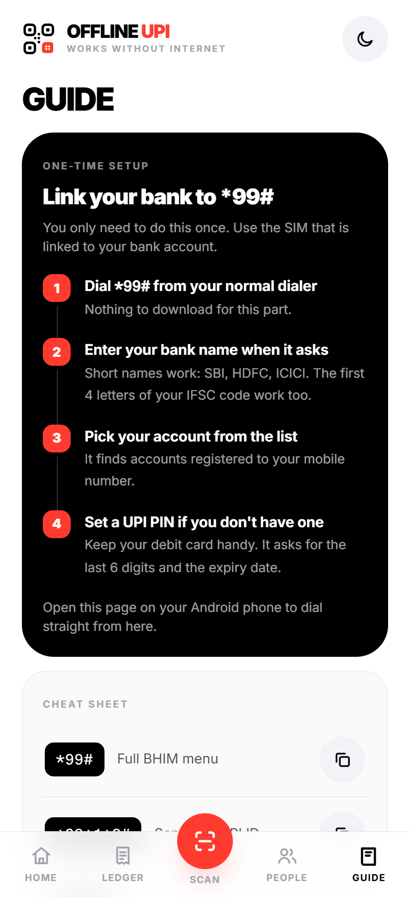
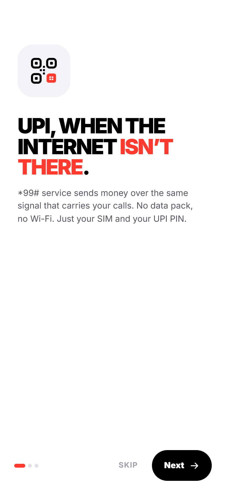

<div align="center">


# Offline UPI

### Send money over UPI with no internet.

Built on India's official `*99#` USSD channel, so a payment goes through on a ₹0
data pack, in a dead zone, or on any phone with a voice signal.

<br/>

[](https://offlineupi.vercel.app)
&nbsp;
[](https://offlineupi.vercel.app)
&nbsp;
[](LICENSE)

<br/>



</div>

---

## Why I built it

Every UPI app I use, GPay, PhonePe, Paytm, stops working the moment the data
does. In a lot of India that happens all the time: weak rural signal, a finished
data pack, a cheap phone, a basement. The payment fails exactly when you can't
fall back to cash easily.

There's already a fix for this that almost nobody uses. `*99#` is a USSD service
run by NPCI (the same body behind UPI) that works over the voice-call channel,
so it needs no data at all. The problem is that using it raw is painful: you
dial a code, then type a full UPI ID like `ramesh.kumar1987@oksbi` into a plain
text menu that times out in about 30 seconds.

The service works. The experience is what stops people. So I built a proper app
in front of it.

## What it does

You set up the payment in a normal, modern interface: pick a saved person, type
an amount on a real keypad, check the details. Then the app does the annoying
part for you. It copies the UPI ID to your clipboard, opens your dialer with
`*99*1*3#` already entered, and shows you exactly which prompts the carrier is
about to ask, in order, so you're never guessing. You enter your UPI PIN in the
carrier's own screen and the money moves.

No data used, no account, no server, nothing stored off your phone.

<div align="center">
<br/>

&nbsp;

&nbsp;

<br/>
<sub><b>Enter an amount &nbsp;·&nbsp; Check it before dialing &nbsp;·&nbsp; A ledger you keep on your phone</b></sub>
</div>

---

## How it works

The app never handles the money itself. It gets everything ready and keeps your
records; the carrier and your bank do the actual transfer.

```
you                     Offline UPI                         carrier / NPCI / bank
─────                   ───────────                         ─────────────────────
pick payee & amount ──▶ validates, saves to ledger
                        copies UPI ID, opens the
                        dialer with *99*1*3#   ──────────▶  USSD session over the
                                                            voice channel
answer 4 prompts   ◀── shown to you in advance             (no data used at all)
(paste ID, amount,
 note, UPI PIN)                                             bank makes the
                                                            UPI transfer
"did it go through?" ─▶ you confirm → ledger
```

---

## Some decisions I had to make

A browser genuinely cannot drive the USSD session on its own; that needs
Android's accessibility layer, which only a native app can touch. I could have
faked a "sent" screen anyway. I didn't. The app is honest about being a
companion to the dialer and just makes that handoff as smooth as possible.

For the same reason, the app can't see whether a payment actually succeeded, so
it doesn't pretend to. Each payment is saved as *unconfirmed*, and you mark it
sent or failed after checking your bank's SMS. The home screen quietly asks
about the last one. I'd rather the app admit what it doesn't know than show a
green tick it can't back up.

On safety, the UPI PIN is only ever typed into the carrier's own popup, never
into this app. There's no server, so there's nothing to breach and nothing to
leak; clearing the site data wipes everything. There's a short "stay safe" note
covering the two mistakes behind most UPI scams, and a one-time terms step on
first launch.

A few things I chose to leave out on purpose. No reading your SMS to
auto-categorise spending, because web apps can't read SMS at all and I think
that's the right boundary anyway. No Jio support, because Jio's network never
implemented `*99#`; the app tells you that instead of silently failing. No
accounts, no analytics, no ads.

---

## More of it

<div align="center">

&nbsp;

&nbsp;

&nbsp;

<br/>
<sub><b>Scanning a live UPI QR &nbsp;·&nbsp; Your own QR to get paid &nbsp;·&nbsp; A plain-English *99# guide &nbsp;·&nbsp; First-run walkthrough</b></sub>
</div>

- Live UPI-ID validation with a hint about which app an ID belongs to (`@ybl`
  usually means PhonePe), an Indian-style keypad (`1,23,456`), the amount spelled
  out, and the ₹5,000 `*99#` limit enforced before you dial.
- Scan any UPI QR with the camera or from a saved image, decoded on the device.
  It uses the browser's native detector where there is one, and a bundled
  decoder (jsQR) where there isn't, so scanning works on iOS too.
- A receive screen with your own QR (generated in-app) and an optional amount.
- Saved people, because typing a UPI ID into a USSD box twice is once too many.
- A ledger with the month's total, each entry showing the status you gave it.
- A guide covering the one-time bank setup, a `*99#` cheat sheet, which carriers
  work, and straight answers to the common questions.
- Installs as a PWA and runs fully offline after the first visit. Light and dark.

---

## How it's built

- The QR codes on the receive screen are generated by a custom QR encoder
  (byte mode, Reed-Solomon error correction, mask selection), around 300 lines
  with no libraries. The tests verify it by generating codes and decoding them
  back with a separate library.
- No framework and no build step. Plain ES modules and a CSS design system, a
  couple of dozen small files.
- Offline-first with a service worker that precaches everything, so after the
  first load it makes no network requests. That's the whole point of the product,
  so I wanted it to be literally true.
- Went through a security pass: every value a user or a QR can supply is escaped,
  and there's a strict Content-Security-Policy plus the usual hardening headers.
- Has tests: a logic suite for the tricky parts, a round-trip check for the QR
  encoder, and a script that drives every screen end to end.

### Tech

| Area | Choice |
|------|--------|
| Language | Vanilla JavaScript (ES modules) |
| UI | CSS, no framework |
| Type | Inter, plus a mono for `*99#` codes, self-hosted |
| QR | Custom encoder, no library |
| Scanning | `BarcodeDetector`, with a bundled jsQR fallback |
| Storage | `localStorage` |
| Offline | Service worker, precache everything |
| Hosting | Vercel, static with security headers |

---

## Running it locally

It's a static site, so any static server works. It does need to be served over
HTTP (not opened as a `file://`) for ES modules and the service worker.

```bash
npm run dev
# or: npx serve .
# or: python -m http.server 8000
```

Open it on an Android phone in Chrome for the full flow (the dialer handoff and
the camera scanner need a real device); on desktop it runs in a look-around mode
with copy-the-code fallbacks.

## Tests

```bash
npm install
npm test
```

Three suites run:

- `test/logic.test.mjs` — the pure logic: UPI-ID validation, amount parsing and
  Indian grouping, amount-in-words, `upi://` parse and build, USSD links.
- `test/qr-roundtrip.test.mjs` — generates QR codes across every version
  boundary and a fuzz sweep, then decodes them back with `jsQR` to prove the
  encoder is correct.
- `test/app.test.mjs` — boots the whole app in a headless DOM and walks
  onboarding, the pay flow, the ledger, people, receive, guide, and scan.

## Project structure

```
offline-upi/
├── index.html            app shell and the SVG icon sprite
├── css/app.css           the whole design system
├── js/
│   ├── main.js           boot and a small hash router
│   ├── store.js          one localStorage-backed store
│   ├── upi.js            VPA rules, upi:// parse/build, money formatting
│   ├── ussd.js           the *99# codes, tel: links, carrier facts
│   ├── qr.js             the QR encoder
│   ├── ui.js             DOM helpers: sheets, toasts, avatars
│   ├── legal.js          the shared legal notice
│   └── screens/          one module per screen
├── sw.js                 the service worker
├── tools/                the icon generator
├── test/                 the three test suites
├── icons/ fonts/         self-hosted assets
└── docs/                 screenshots for this README
```

---

## Design

Black, white, and one red, with Inter doing the heavy lifting from regular up to
its heaviest weight. Big rounded cards, tight headlines, small tracked labels.
Red is kept for the few things that matter (sending money, the scan button,
failures) so it stays meaningful. The app icon is a QR grid joined with a SIM,
the two halves of what the product is.

---

## Compatibility

- **Android (Chrome):** the full flow. The dialer opens with `*99*1*3#` already
  entered, and the camera scans QR codes.
- **iPhone / iPad (Safari):** prepare payments, scan QR codes (a bundled decoder
  covers the missing native one), keep your ledger, and install to the home
  screen. iOS blocks `*` and `#` in dialer links, so it shows you the code to
  dial by hand rather than opening the dialer for you.
- A payment needs a voice SIM on Airtel, Vi, or BSNL. `*99#` is not available on
  Jio.

## Try it

**[offlineupi.vercel.app](https://offlineupi.vercel.app)**. Open it on an Android
phone in Chrome for the full flow, or on anything to look around, and add it to
your home screen to see it as an installed app.

---

## License

Copyright (c) 2026 Aayush Gupta. All rights reserved. Source-available for
viewing and evaluation; not open source. Reuse, redistribution, and derivative
works are not permitted without written permission. See [LICENSE](LICENSE).

## Legal

Offline UPI is an independent, non-commercial application developed by Aayush
Gupta for demonstration and portfolio purposes. It is not a financial product or
service, and it is not affiliated with, endorsed by, or sponsored by NPCI, BHIM,
any banking institution, or any telecom operator.

The application does not hold, transmit, or receive funds. It prepares payment
details and hands off to your device's native dialer. All transactions are
executed over your carrier's `*99#` USSD service and your bank's infrastructure,
and are authorised solely by you using your UPI PIN.

The application is provided free of charge, on an "as is" and "as available"
basis, without warranties of any kind, express or implied. To the maximum extent
permitted by law, the developer accepts no liability for any loss or damage
arising from its use, including failed, delayed, or incorrect transfers, carrier
charges, or fraud or scams committed by third parties. Any dispute concerning a
transaction must be raised with your bank, where the transaction is actually
processed.

By accessing or using the application, you acknowledge that you have read and
understood this notice and agree to be bound by it, including the exclusion of
liability set out above.

---

## Contact

I'm currently looking for work. If you're hiring, I'd be glad to talk.

**Aayush Gupta**
[Portfolio](https://aayushguptaportfolio.vercel.app) ·
[LinkedIn](https://linkedin.com/in/aayush02) ·
[GitHub](https://github.com/AayushXL5) ·
[aayush.gupta.real@gmail.com](mailto:aayush.gupta.real@gmail.com)
